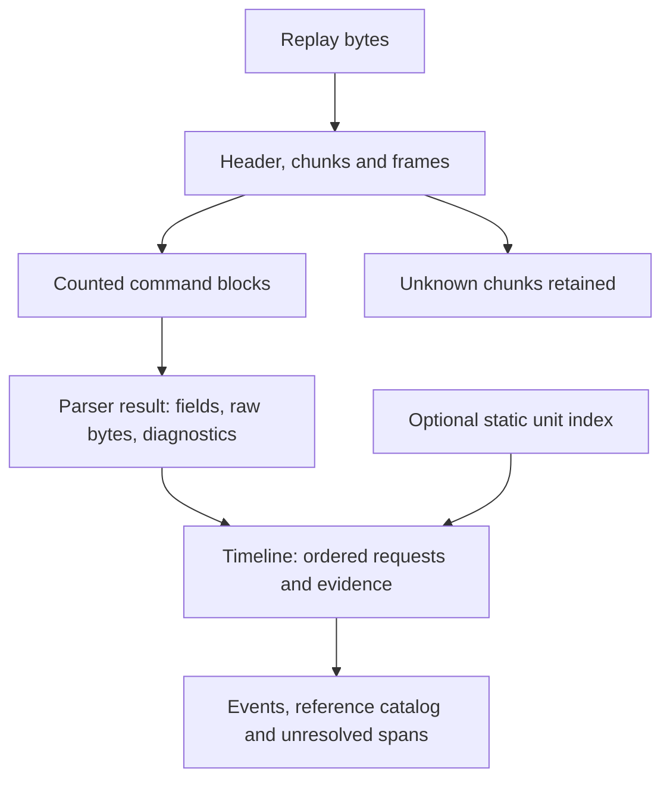

# Architecture

[Overview](../README.md) · [Documentation map](README.md) · [Binary format](../FORMAT.md) · [Research index](../research/INDEX.md)

The decoder has two deliberate boundaries: exact byte parsing, then qualified
interpretation. Static unit data can enrich the latter; it cannot reconstruct a
running game. `wgrd_corpus.py` checks collections using both layers.

A timeline describes serialized requests. The simulation is conspicuously absent.

## Evidence conventions

This is the documentation's authoritative reading guide for classifications.
[AGENTS.md](../AGENTS.md) specifies the operational evidence requirements;
historical notes retain the vocabulary they originally used.

### Structure, confidence and meaning are separate

| Question | Values | Scope |
|---|---|---|
| Did a block consume its declared commands and bytes? | `complete`, `framed`, `unresolved`, `malformed` | Parser block result; defined in section 1 |
| Did this command expose fields or just a boundary? | `layout`, `opaque`; event-only `unknown`, `unresolved_boundary` | Per-command `field_decode_status`, exported as event `decode_status`; unknown single tails have a boundary, multi-command placeholders share an unresolved span |
| Does the replay match the layout's source build? | `matching_build`, `inferred_build_59638` | Timeline `layout_status`, independent of semantic confidence |
| What meaning is supported? | `verified`, `partial`, `inferred`, `unknown` | Event `interpretation.status`; defined in section 2 |
| How well is a research claim supported? | Uppercase documentation labels below | A specific claim and its evidence, not an output field |

`complete` means the bytes add up. It says nothing about whether the interpretation
is right. `opaque` is a structural label, never an interpretation confidence.

### Documentation confidence labels

Use **confirmed** for a claim directly reproduced within its stated build/sample
scope, **inferred** for an extrapolation, and **unknown** for what has not been
determined. A confirmed field width can still have unknown meaning.

Historical references retain **VERIFIED**, **CONFIRMED**, **STRONGLY SUPPORTED**,
**TENTATIVE** and **UNRESOLVED** where their distinctions matter. Do not mechanically
merge them: strongly supported observations can lack a directly reproduced step,
and tentative meanings are hypotheses. The [research index](../research/INDEX.md)
defines its archival S/T/E/N/G/X evidence-type codes.

These prose labels do not rename parser/runtime statuses. In particular,
`interpretation.status` retains `verified`, `partial`, `inferred` and `unknown`.
“Ground-truth verified” is a bounded UI/recording observation, not an automatic
upgrade to exported `verified`.

### Read and write a claim

Keep **observation** (bytes, control flow, sample values) separate from
**interpretation** (names, roles, gameplay meaning). Identify the executable build
and SHA-256; for code claims, cite VA and file offset, excerpt or evidence record.
For samples, cite manifest identity and SHA-256, reproduction command and relevant
test results. The historical 59638 `.text` conversion is
`file offset = VA − 0x401000 + 0x400`; it is not a general PE conversion rule.

Use neutral object-offset field names until evidence supports an added semantic
name. Label uncertainty where the claim appears. Retain raw values, negative
results and conflicting observations. A digest proves internal integrity; the
sample manifest pins input identity and provenance, without proving the recording
itself genuine.

**Historical vs. current:** code is the authority for implemented behavior;
current references describe that behavior and cite research. Dated notes preserve
what was known then. Corrections belong in a dated addendum or the current
reference with a link back. [NEXT-STEPS.md](../NEXT-STEPS.md) owns priorities.

## 1. Container and command split (`wgrd_replay.py`)

| Stage | Entry point | Result / boundary |
|---|---|---|
| Header | `parse_header(b)` | ESAV version, size and metadata; digest not checked here |
| Chunk walk | `iter_chunks(b, start)` | Bounded 16-byte headers; unknown tags retained |
| Frame assembly | `parse_replay(b)` | Consecutive frames, ordered slots, constant slot count |
| Command split | `decode_command_block(block, count, slot)` | Shared cursor, exact count and EOF; raw block retained |
| File integrity | `parse_replay(b)` | SHA-224 checked after the structural walk by default |

The parser result contains `header`, `metadata`, `stats`, pact `commands` and
`unknown_chunks`. `commands` is a list of pact records, not a flat event list.

- `iter_chunks` raises `ReplayFormatError` on any violation.
- `parse_header` raises `ReplayFormatError` for invalid headers, invalid JSON,
  non-object metadata roots and present non-object `game` values. Missing `game`
  or `Version` remains accepted.
- `_decode_command` returns `None` for opcodes without a layout; the block is then `unresolved`.
- Layouts are keyed by opcode: 0x07, 0x04/0x09/0x0A, 0x08 (`decode_op08`), 0x17, 0x0D, 0x0C, 0x0E, 0x02, 0x13, 0x18.
  Field names follow `obj_XX_u32|hex|u8|array|points` (XX = creator object offset in hex).
- Other opcodes are present in `OPCODE_CLASSES` (class name by RTTI) but have no field layout in this file.
- Command boundaries are exact; a block must consume its declared count and all bytes.

### Block status (`decode_command_block`)

| status       | meaning                                                                          |
|--------------|----------------------------------------------------------------------------------|
| `complete`   | all declared commands decoded with known layouts, exact byte consumption         |
| `framed`     | boundaries known, but at least one command is opaque (0x0D serializer body)     |
| `unresolved` | an opcode without a layout stopped the split; remaining bytes kept as hex        |
| `malformed`  | count out of range, creator bound violated, or trailing bytes                    |

`field_decode_status` per command is `layout` or `opaque`. `opaque` means the length-delimited body is framed, not decoded.

## 2. Timeline and interpretation (`wgrd_timeline.py`)

`build_timeline(parsed, unit_data=None)` emits one event per declared command,
ordered by frame, recorded slot order and serialized command order. It rejects
known malformed parser blocks; unresolved boundaries remain explicit placeholders
and shared spans. Event `source` offsets trace back to the input bytes.

`wgrd_replay.json_safe` supplies the shared non-finite-number representation for
parser CLI output, decoded point fields and timeline output. The former private
helper names remain compatible aliases.

Interpretation dispatch calls the order/production layers, then builds the
reference catalog, optionally enriches production and reference types, and runs
supply-target attribution. Output schema: `wgrd_timeline/1`.

The parser leaves `0x0D` bodies opaque. The timeline's production layer separately
checks supported interiors; its `payload_layout_status` can be `complete` or
`malformed` while the parser block remains `framed`. An interior error produces
an unknown interpretation rather than rejecting the whole timeline.

- Unit data is opt-in: `--unit-data PATH` (with `--timeline`). `load_unit_data` in `wgrd_unit_data.py`
  dispatches to `wgrd_unit_index.load_index` for the build 59638 index file, or to the pinned public 58710 directory.
- `enrich_references` lives in `wgrd_unit_data.py` and is also called from `wgrd_production.py`.

### Interpretation status

| `interpretation.status` | Meaning |
|---|---|
| `verified` | Supported request interpretation on build 59638; execution success not asserted |
| `partial` | Bounded interpretation on 59638 with unresolved semantics or runtime dependencies |
| `inferred` | A supported interpretation transferred to a non-59638 replay by layout |
| `unknown` | No supported interpretation; also used for invalid production interiors |

The build gate compares the replay version with `59638`; unsupported meanings
remain `unknown` on every build. Where emitted, `execution_outcome` is always
`unknown`. UI corroboration of the controlled 131544 sample does not change this
export policy. Raw RTTI names alone are not action interpretations.

| opcode | layout location                 | interpretation location                          |
|--------|---------------------------------|--------------------------------------------------|
| 0x07   | `wgrd_replay._decode_command`   | `wgrd_orders.decode_standard_order`              |
| 0x08   | `wgrd_replay.decode_op08`       | inline in `wgrd_timeline._interpretation`        |
| 0x09   | `wgrd_replay._decode_command`   | inline in `wgrd_timeline._interpretation`        |
| 0x0A   | `wgrd_replay._decode_command`   | `wgrd_production.decode_production_action`       |
| 0x0C   | `wgrd_replay._decode_command`   | `wgrd_production.decode_change_production`       |
| 0x0D   | `wgrd_replay._decode_command` (opaque body) | `wgrd_production.decode_production_action` |
| 0x18   | `wgrd_replay._decode_command`   | `wgrd_entities.attribute_supply_requests` (post-pass) |
| 0x02, 0x04, 0x13, 0x17, 0x0E | `wgrd_replay._decode_command` | none (layout only; `unknown`) |

Field-level meanings and their confidence are in the per-opcode notes linked below.

## 3. Entities and unit data

- `wgrd_entities.reference_components(reference_hex)` splits 0x07 wire references.
- `build_reference_catalog(events, replay_sha256, matched)` keys entries as `sha256:reference_hex`
  and sets `lookup_key_ambiguous` when a 32-bit lookup key is shared.
- `attribute_supply_requests` resolves a 0x18 `obj_04_u32` only when exactly one catalog entry carries the key
  and the issuing slot is among its observed slots. Otherwise `resolution` is `unreferenced_key`, `ambiguous_key`,
  or `slot_mismatch`, and no reference or unit type is assigned.
- `wgrd_unit_data.py` / `wgrd_unit_index.py` join the static build 59638 NDF descriptor index through the validation GUID.
  Source: `research/unit-data/build59638-v1.json.gz` with `research/unit-data/build59638-v1.manifest.json`. The public 58710 snapshot is opt-in and not cached in this repo.

## 4. Generated files and their scripts

| output                                   | produced by                               |
|------------------------------------------|-------------------------------------------|
| `research/coverage.json`                 | `python3 -B research/coverage.py > research/coverage.json` |
| `research/timeline-coverage.json`        | `python3 -B research/timeline_coverage.py` (stdout) |
| `research/op07-coverage.json`            | `research/op07_coverage.py` (stdout)       |
| `research/production-coverage.json`      | `research/production_coverage.py` (stdout) |
| `research/entity-coverage.json`          | `research/entity_coverage.py` (stdout)     |
| `research/public-unit-coverage.json`     | `research/public_unit_coverage.py <dir>` (stdout) |
| `research/unit-data/build59638-v1.json.gz` | `research/export_unit_index59638.py` (see its header; inputs come from the git-ignored `work/` NDF extraction) |

Regenerate, then explain the diff in the commit or note. Counts are read from these files, not from docs.
Sample inputs are read from `samples/manifest.json` (external bytes, not in Git).

## 5. Canonical documents

| topic                              | canonical file                                  |
|------------------------------------|-------------------------------------------------|
| byte-level container and layouts   | [FORMAT.md](../FORMAT.md) |
| per-opcode command layouts         | [research/COMMAND-LAYOUTS.md](../research/COMMAND-LAYOUTS.md) + per-opcode notes ([research/FIXED-OPCODES-02-13-18.md](../research/FIXED-OPCODES-02-13-18.md), [research/CHANGEPRODUCTION-0C.md](../research/CHANGEPRODUCTION-0C.md), [research/OP07-ORDERS.md](../research/OP07-ORDERS.md), [research/PRODUCTION-COMMANDS.md](../research/PRODUCTION-COMMANDS.md)) |
| current output/status contract | This reference and [FORMAT.md](../FORMAT.md) |
| timeline interpretation evidence | [research/TIMELINE-SEMANTICS.md](../research/TIMELINE-SEMANTICS.md) |
| entities and reference keys        | [research/ENTITY-CONTEXT.md](../research/ENTITY-CONTEXT.md), [research/OP18-REFERENCE-KEYS.md](../research/OP18-REFERENCE-KEYS.md), [research/OP18-SUPPLY-TARGETS.md](../research/OP18-SUPPLY-TARGETS.md) |
| executable analysis (addresses)    | [REA-NOTES-59638.md](../REA-NOTES-59638.md)                            |
| research provenance                | [research/INDEX.md](../research/INDEX.md)                             |
| current-build experiment and Phase 2 | [research/current-build/2026-10-28-controlled-experiment.md](../research/current-build/2026-10-28-controlled-experiment.md), [research/current-build/PHASE-2-HANDOFF.md](../research/current-build/PHASE-2-HANDOFF.md) |
| priorities                         | [NEXT-STEPS.md](../NEXT-STEPS.md)                                 |
| usage and API                      | [docs/USAGE.md](USAGE.md) |
| onboarding and navigation          | [README.md](../README.md), [documentation map](README.md) |
| contribution and validation        | [CONTRIBUTING.md](../CONTRIBUTING.md) |

Use these documents as the current reference for their topic, and the implementation
as the authority on implemented behavior. Record contradictions and cite the
correction; an old note does not override the current code.

## Development checks

[CONTRIBUTING.md](../CONTRIBUTING.md) owns setup, fixture requirements and CI commands.
The portable preservation check verifies historical records, archived evidence
copies and the cow; it does not freeze all implementation files. Historical
verifiers remain available for reproducing the original audits. The
[maintenance review](DEVELOPMENT-REVIEW.md#repository-rationalization-2026-10-28)
explains the three exact accepted script revisions and preservation boundaries.
