# The Oshkosh Incident of October 28, 2026

> One truck. Two fuel toggles. A black framebuffer that was not a black game.

This is the visual record of the first controlled current-build replay experiment in this project. The joke is the title; the evidence stays literal.

## Start here

- [Comprehensive experimental report](2026-10-28-controlled-experiment.md): environment, executable identity, failures, workaround, chronological log, findings, limitations, and reproduction.
- [Command and screenshot evidence ledger](2026-10-28-evidence.json).
- [Cross-build replay provenance and regression expectations](../../samples/cross-build-manifest.json).
- [Current C# helper](tools/WgrdUi.cs), [experiment version](history/WgrdUi-v2.cs), and [exact initial version](history/WgrdUi-v1.cs). The later helper additions have not been exercised in the VM.
- [Phase 2 handoff](PHASE-2-HANDOFF.md): proposed timing and movement work, not authorization to run it.
- [Complete versioned screenshot archive](https://github.com/archpc/wgrd-replay/releases/tag/oshkosh-incident-2026-10-28-v1) and [archive manifest](screenshot-archive-manifest.json).

## Preservation without clone inflation

The repository contains **7 original PNGs** (52,471,638 bytes) and **12 lightweight JPEG thumbnails** (1,427,934 bytes). The release ZIP preserves **all 43 original screenshots**, totaling **312,109,052 uncompressed bytes**, including three incidental guest-desktop diagnostics that are not featured below. Original PNG bytes were not re-encoded. Thumbnails are explicitly lossy browsing derivatives.

The ZIP is 311,677,181 bytes. SHA-256:

```text
b2f7b5e417fe48786372db1badd054c64c6bf04ae7c6e86203aeb804d42a1da8
```

After downloading, verify the ZIP against its release checksum. After extraction, run:

```sh
shasum -a 256 -c SHA256SUMS
```

The archive contains screenshots, a manifest, checksum list, and archive README only. It contains no replay bytes, game executable, credentials, or private session transcript. The screenshots may show the game profile name and incidental desktop filenames; publication was authorized by the repository owner.

## Visual timeline

Click a thumbnail for an original PNG when it is part of the curated set. Otherwise the link opens the complete release archive page. Filenames and hashes identify originals in the manifest. Capture timestamps are observation times, not exact input-event timestamps.

### 1. The framebuffer that was not the game

[](screenshots/parallels-black-after-gdi-success.png)

Parallels returned black even near a successful, foreground-verified guest GDI capture. This is a capture-path observation, not proof of a dead renderer.

Original: parallels-black-after-gdi-success.png. [Open full-resolution PNG](screenshots/parallels-black-after-gdi-success.png).

### 2. The menu was there all along

[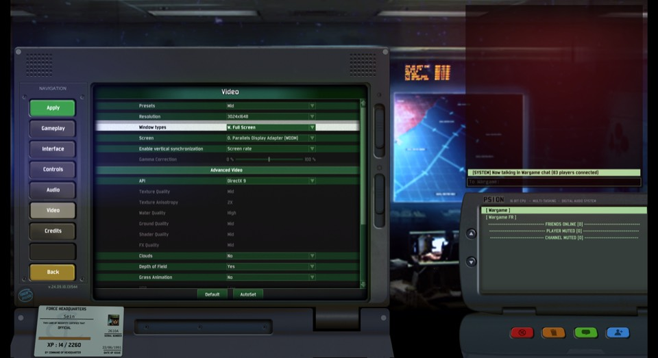](screenshots/wgrd-full-menu.png)

Full-resolution guest capture exposed the settings screen and v.24.09.10.131544. The user selected windowed fullscreen; DirectX 9 remained unchanged.

Original: wgrd-full-menu.png. [Open full-resolution PNG](screenshots/wgrd-full-menu.png).

### 3. An isolated battlefield

[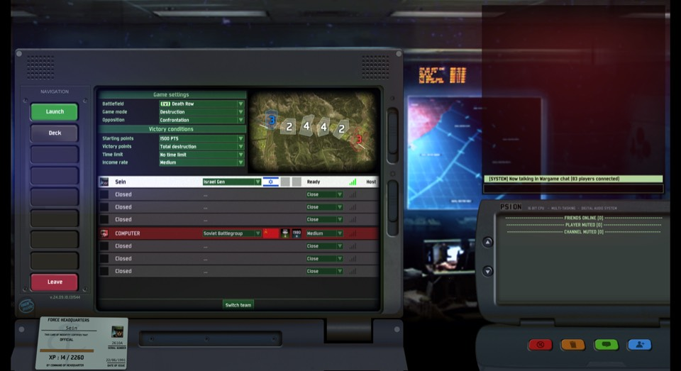](https://github.com/archpc/wgrd-replay/releases/tag/oshkosh-incident-2026-10-28-v1)

Death Row, 1v1, Destruction, one player against Medium AI. The VM adapter was verified Disconnected before recording.

Original: wgrd-skirmish.png. [Available in the complete archive](https://github.com/archpc/wgrd-replay/releases/tag/oshkosh-incident-2026-10-28-v1).

### 4. Enter the Oshkosh

[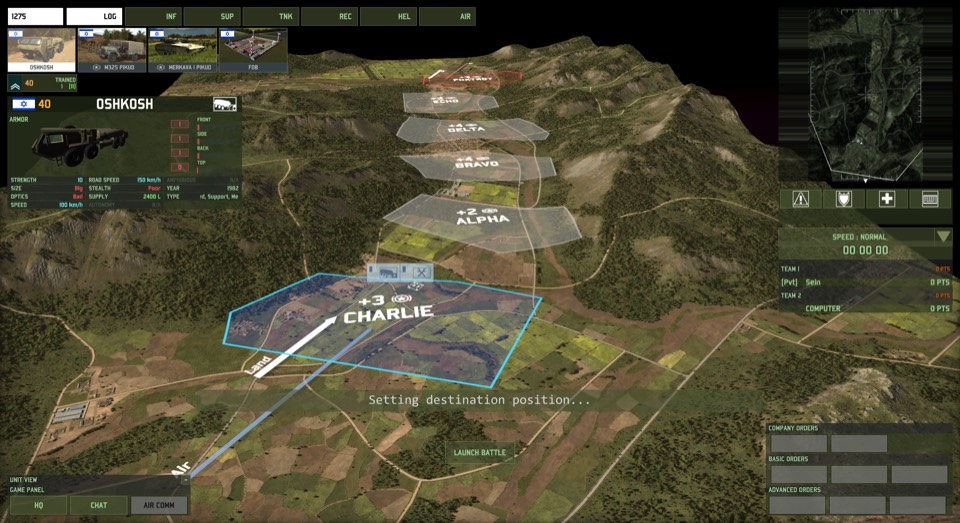](https://github.com/archpc/wgrd-replay/releases/tag/oshkosh-incident-2026-10-28-v1)

The deployment UI exposed the Oshkosh and its 2400 L supply capacity. This selection screenshot precedes placement.

Original: wgrd-truck-select.png. [Available in the complete archive](https://github.com/archpc/wgrd-replay/releases/tag/oshkosh-incident-2026-10-28-v1).

### 5. One truck on the ground

[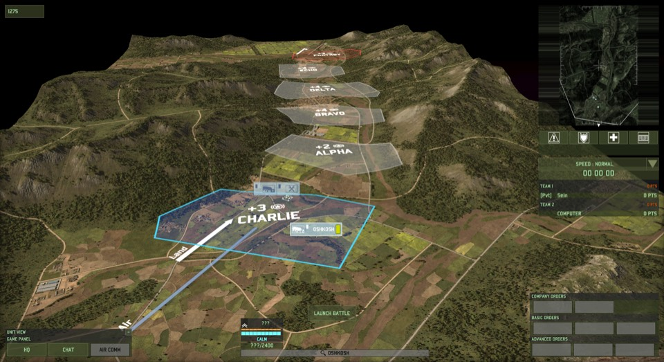](screenshots/wgrd-truck-placed.png)

A solid OSHKOSH label appeared in Charlie. The candidate production request is at frame 885; automatic setup records are separate.

Original: wgrd-truck-placed.png. [Open full-resolution PNG](screenshots/wgrd-truck-placed.png).

### 6. The other clock begins

[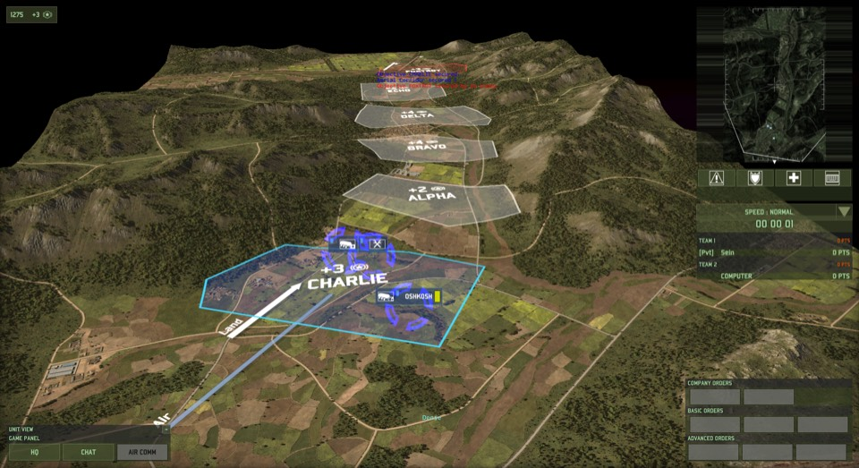](https://github.com/archpc/wgrd-replay/releases/tag/oshkosh-incident-2026-10-28-v1)

Launch Battle started the displayed battle clock. Replay recording had already accumulated deployment time.

Original: wgrd-battle-start.png. [Available in the complete archive](https://github.com/archpc/wgrd-replay/releases/tag/oshkosh-incident-2026-10-28-v1).

### 7. An order is not an arrival

[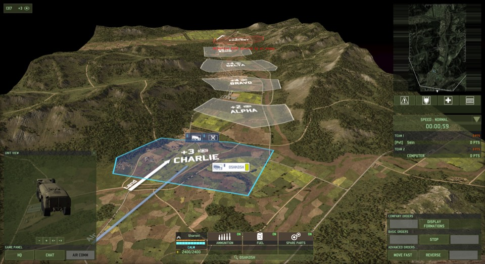](https://github.com/archpc/wgrd-replay/releases/tag/oshkosh-incident-2026-10-28-v1)

A ground right-click was issued for the selected truck. The replay contains one 0x07 request. Arrival, trajectory, and coordinate mapping were not established.

Original: wgrd-move-issued.png. [Available in the complete archive](https://github.com/archpc/wgrd-replay/releases/tag/oshkosh-incident-2026-10-28-v1).

### 8. Fuel: OFF

[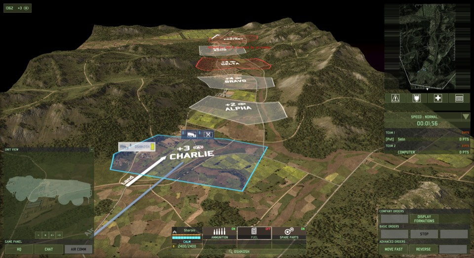](screenshots/wgrd-fuel-off.png)

Live controlled observation: Fuel changed to OFF; Ammunition and Spare Parts stayed ON. The corresponding 0x18 candidate is frame 1638, raw channel 2, final byte 0.

Original: wgrd-fuel-off.png. [Open full-resolution PNG](screenshots/wgrd-fuel-off.png).

### 9. Fuel: ON

[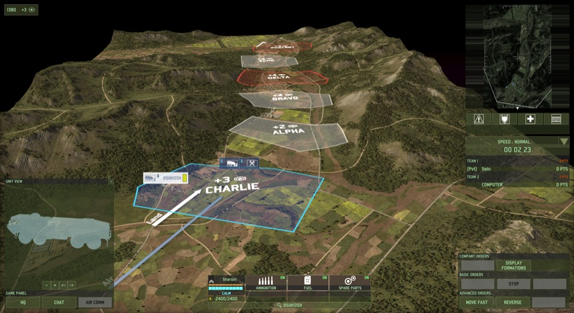](screenshots/wgrd-fuel-on.png)

Live controlled observation: Fuel changed back to ON. The second 0x18 candidate is frame 1771, same registry key and channel, final byte 1. No actual fuel transfer is claimed.

Original: wgrd-fuel-on.png. [Open full-resolution PNG](screenshots/wgrd-fuel-on.png).

### 10. A very small defeat

[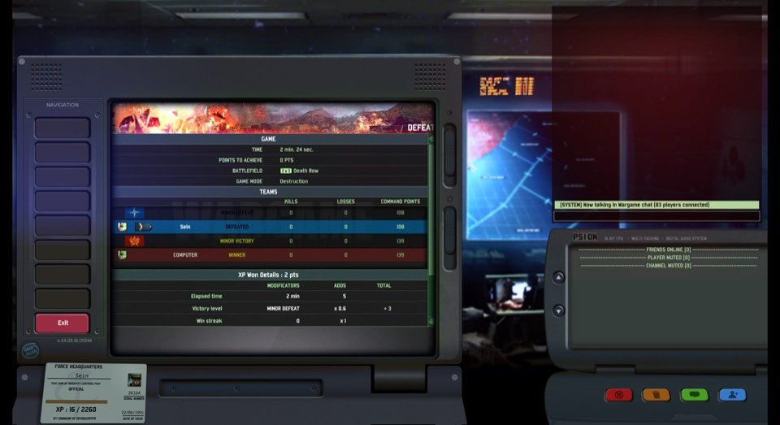](https://github.com/archpc/wgrd-replay/releases/tag/oshkosh-incident-2026-10-28-v1)

The controlled skirmish ended at 2 min. 24 sec. The original replay was copied and hash-verified, never moved or overwritten.

Original: wgrd-postmatch.png. [Available in the complete archive](https://github.com/archpc/wgrd-replay/releases/tag/oshkosh-incident-2026-10-28-v1).

### 11. The recording plays

[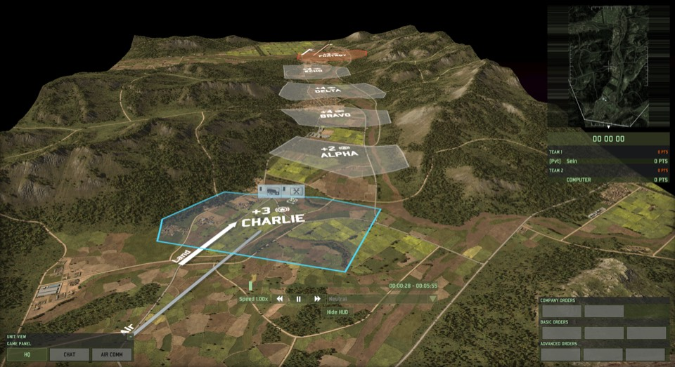](screenshots/wgrd-playback-loaded.png)

The new replay loaded with transport controls. Replay time advanced while battle time was still zero. Total replay duration displayed 5:55, not 2:24.

Original: wgrd-playback-loaded.png. [Open full-resolution PNG](screenshots/wgrd-playback-loaded.png).

### 12. Back to the same result

[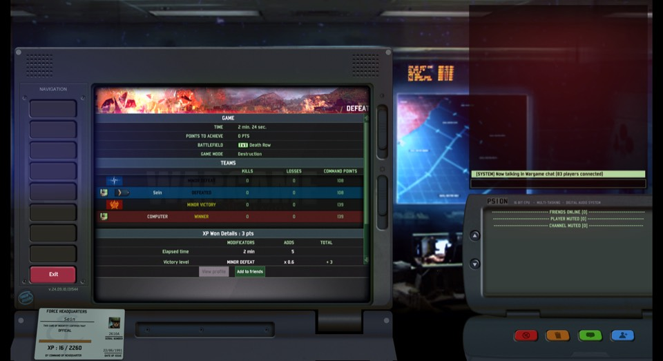](screenshots/wgrd-playback-exit-menu.png)

Playback reached the same Death Row defeat and 2:24 result. The game was then stopped, the original replay rehashed, and the VM network restored.

Original: wgrd-playback-exit-menu.png. [Open full-resolution PNG](screenshots/wgrd-playback-exit-menu.png).

## What this milestone does not claim

- Structural success on one revision-131544 recording is not universal current-build support.
- Historical archive Versions 510061340 and 510064564 are separate evidence, not newest-build evidence.
- Live fuel-control changes were observed. The playback OFF/ON transition was not independently recaptured.
- Movement execution, world coordinates, markers, production changes, and cancellations remain unresolved.
- All existing non-59638 semantic statuses and execution-outcome fields remain conservative.

## Reproduce the engineering

Follow the [report’s computer-use procedure](2026-10-28-controlled-experiment.md#reproduction-from-a-mac-using-parallels-mcp) to stage and run WgrdUi.cs. It uses foreground-checked native input and GDI capture. It is not a driver installed into the game, does not read game memory, and does not bypass security controls.

The corpus runner and its tests are in [wgrd_corpus.py](../../wgrd_corpus.py), [runner tests](../../tests/test_corpus.py), and [hash-pinned authentic tests](../../tests/test_cross_build_corpus.py).
